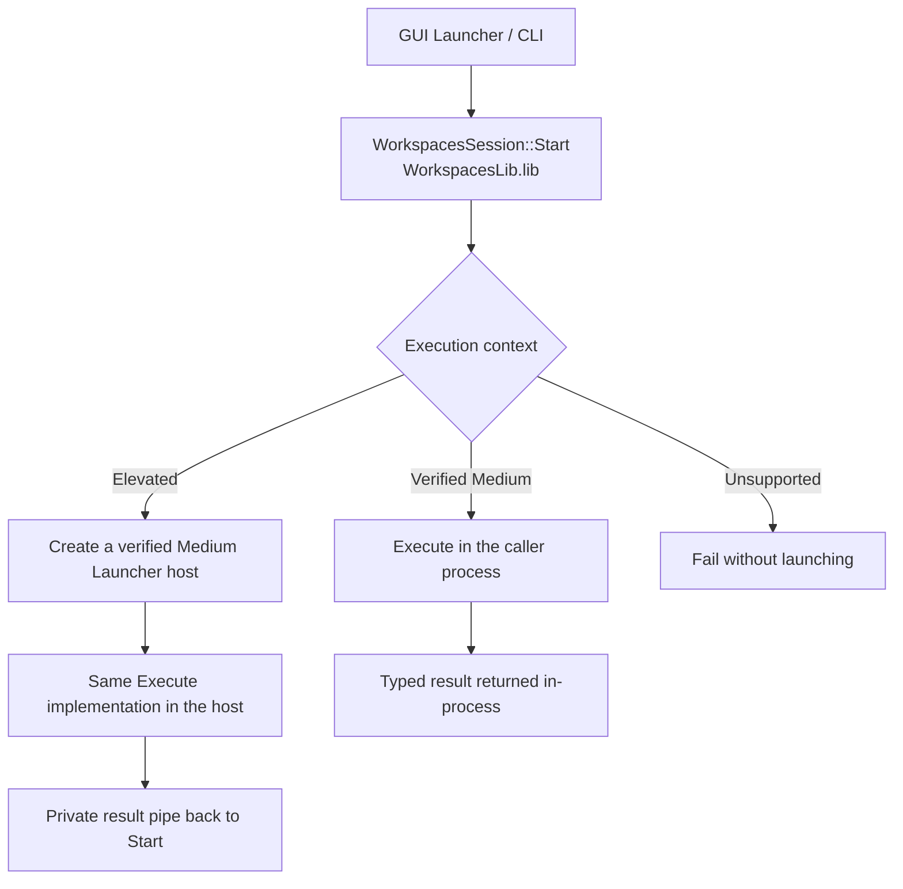

# Workspaces command-line interface

Related issue: #49900. This interface lists saved workspaces and launches one through the existing
Workspaces engine. It does not capture, create, import, delete or edit workspace configurations.

## Installation

The installer adds only `<PowerToys installation>\bin` to PATH. `PowerToys.Workspaces.CLI.exe`
in that folder is the shared native CLI shim, not the application payload. It launches
`..\PowerToys.WorkspacesCLI.exe` using the installed-relative mapping.

Do not add the installation root or `WinUI3Apps` to PATH. Those folders contain application/runtime
DLLs and are not command directories. The wrapper avoids advertising those DLL locations through
PATH; it does not replace the operating system's DLL security rules.

The manifest and WiX component list are checked together. The real CLI and shared shim are included
in release signing, and installer shutdown recognizes both process names. See
[CLI conventions](..\cli-conventions.md).

## Commands

```text
PowerToys.Workspaces.CLI.exe list [--json]
PowerToys.Workspaces.CLI.exe list --id <guid> [--details] [--json]
PowerToys.Workspaces.CLI.exe list --name <name> [--details] [--json]
PowerToys.Workspaces.CLI.exe launch --id <guid> [--timeout <seconds>] [--json]
PowerToys.Workspaces.CLI.exe launch --name <name> [--timeout <seconds>] [--json]
```

Help/version do not require an enabled module. Both operational commands reject user-disabled
or policy-disabled Workspaces. Configured GPO overrides the user toggle exactly as in Settings.
The Runner need not be running when the effective module configuration is enabled.

Use exactly one selector for launch or detail. GUID matching accepts braces and either case,
without rewriting stored IDs. Name matching is exact, ordinal and case-insensitive; ambiguous
names fail rather than selecting the first workspace. An explicit missing selector target is
an error; an enabled module with no workspace file has an empty unfiltered list.

## Data contract

`--json` returns one UTF-8 document. Successful `list` responses contain only `view` and
`workspaces` at the top level, without a `schemaVersion`, `command`, `state` or `result` wrapper.
Launch responses and errors keep the envelope with `schemaVersion`, `command`, `state` and
`result` or `error`. Failed queries return a structured error and a nonzero exit code, never an
empty successful list.
Public JSON is formatted with line breaks and two-space indentation, followed by a newline,
including when stdout is redirected. It is one JSON object, not a quoted JSON string or
newline-delimited JSON records. Formatting does not alter stored field names or values.
The private worker/confirmation protocol is unchanged.
Warnings are structured separately and never replace an application failure.

Summary entries are a subset of the existing stored workspace JSON:

```json
{
  "view": "summary",
  "workspaces": [
    {
      "id": "{6CF910A2-D2E0-436D-A50E-41432A88452A}",
      "name": "Development",
      "applications": [
        { "application": "Notepad" },
        { "application": "Microsoft Edge" }
      ]
    }
  ]
}
```

Both unfiltered and selected lists contain `view: "summary"` or `"detail"` and a top-level
`workspaces` array, even for one selected workspace or no workspaces. Scripts can read
`.workspaces` directly. Summary preserves application order, duplicates, field names, types
and values; no `apps`, per-app `name`, or count alias is added.

Detail reuses the native workspace serializer, including existing kebab-case names, timestamp
units and monitor/DPI configuration. Paths and command arguments may contain sensitive data:
request detail deliberately and protect redirected output. Runtime handles/process IDs are not
part of stored workspace JSON.

Launch results contain the workspace and operation IDs, per-application results and a separate
persistence status. An observed arranged state does not certify that a document/tab has loaded
or that an application is ready for business use.
If launch-history verification fails with `persistenceUnverified`, exit code 11 is preserved:
text mode writes the error to stderr and the observed application results to stdout; JSON mode
includes both in its single response. Do not rerun the workspace merely to recover those results.

Per-application `launched` preserves the native `Launched` state: the application launch succeeded,
but window arrangement was not confirmed. A localized `message` explains this distinction.
`arrangeFailed` is reserved for a native failed result without a recorded application-launch error;
recorded launch errors remain `launchFailed`. `arranged` means the engine confirmed arrangement.
Aggregate state distinguishes launch progress from fully confirmed restoration:

| Application outcomes | Aggregate state | Exit code |
|---|---|---:|
| Every application is `arranged` | `completed` | 0 |
| At least one is `launched` or `arranged`, but not all are `arranged` | `partial` | 10 |
| None is `launched` or `arranged` (for example, all skipped or failed) | `failed` | 10 |

Thus `skipped` plus `launched` is `partial`, not `failed`. Exit codes remain unchanged:
unconfirmed arrangement is not counted as a fully restored workspace.
Final arranger responses must contain a known outcome for every requested application.
`Waiting`, fractional/out-of-range numeric states, missing/duplicate applications and invalid results
are rejected before applying or acknowledging completion. They produce `outcomeUnknown` (exit 9), not an application-level
`unknown` with exit 10. Native `Launched` remains valid and is reported as `launched`.

## Launch behavior

- Launch waits for an explicit final arranger result. There is no accepted-only/no-wait mode.
- The default total deadline is 120 seconds; `--timeout` accepts 1 through 600.
- At the deadline the shared launcher cancels its pending confirmation and allows up to two seconds for
  execution to acknowledge completion. An acknowledged timeout reports `timeout`; an absent,
  malformed or unresponsive final result reports `outcomeUnknown`. This does not extend app-launch
  or approval time. An unresponsive in-process operation retains its owned state until the Shell call
  returns or the one-shot adapter exits after reporting the error; no unsafe thread termination is used.
- Workspaces progress/editor windows are suppressed. The existing Workspaces signature confirmation
  dialog, application windows and normal Windows UAC remain possible.
- Console applications launched as workspace targets get their own console rather than sharing
  the CLI's console. The CLI keeps its original console and standard streams.
- Both ordinary and administrator terminals use the same command. The shared session layer runs
  directly inside a verified Medium caller; only an elevated caller starts a Medium Launcher host
  in the same user's desktop session. Existing saved elevation flags still determine individual app/UAC
  behavior; the administrator caller does not implicitly elevate every app.
- Existing windows follow the saved `move-existing-windows` setting. Another launch in the same
  session returns busy rather than queueing or taking over.
- Ctrl+C requests stopping further launches. Already-started applications are not killed and
  window positions are not rolled back. A blocked operation without acknowledgment is reported
  as unknown outcome, not canceled.
- A timeout does not mean that a Windows consent dialog was dismissed. Do not automatically retry:
  launch is not idempotent and repeating it may open more applications.
- The shared executor and arranger use the same immutable selected snapshot. Final history writes read
  the current file under a shared writer lock and do not replace it with the old launch snapshot.
  The initial snapshot exchange waits for both IPC endpoints within its startup deadline before
  sending the first request, so asynchronous pipe creation cannot discard it or its reply.
- Before launching legacy workspaces, the Medium executor assigns and safely persists only
  missing application IDs. Existing IDs are preserved; malformed or duplicate existing IDs are
  errors. Concurrent edits or failed ID persistence stop the launch before applications start.
  Listing remains read-only, and a later canceled/timed-out launch does not undo completed ID initialization.
- The foreground CLI changes the console output code page only while writing output, flushes
  those writes and restores it before returning to other work; launch waits leave it unchanged.
  Elevated callers receive the host result through a private pipe, independent of console output and CLI localization.
- File logging is best-effort. An unavailable log directory/file does not prevent launching;
  the final launch result includes a `loggingUnavailable` warning without changing application outcomes.

### Shared session and administrator routing

The CLI and GUI launcher are adapters over `WorkspacesSession::Start`. The entry and execution core
are statically linked from `WorkspacesLib`, including the existing Launcher/AppLauncher implementation.
`Start` selects an immutable snapshot and checks context. A Medium caller invokes the shared `Execute`
in the same process, without another Launcher process, snapshot mapping or result pipe. An elevated
caller creates a verified Medium `PowerToys.WorkspacesLauncher.exe` host that invokes the same `Execute`.
Unsupported contexts fail; no path executes the core at High IL.
`Execute` owns one preparation/launch/history flow and returns a typed outcome; only the CLI adapter
creates the public JSON, text and exit-code representation.



The GUI retains progress presentation and its invocation context, including unsaved Launch-and-Edit
drafts; CLI mode only displays required confirmation UI. No Editor save-workflow changes are added.
Launch and Edit can start an already-saved workspace without a temporary draft. A missing
`temp-workspaces.json` falls back to saved configuration; an existing malformed draft remains an
error, and a valid matching draft takes precedence.

The progress window's Cancel button and CLI cancellation both stop the shared launch wait and return
an acknowledged `canceled` result without requiring normal arranger completion. Pending application
launches stop, already-started applications remain open, and operation-owned workers and the launch
lock are released. Non-canceled launches still require a complete, validated arranger result.

For elevated callers, shared session routing validates the desktop shell's
user/session/Medium integrity, creates a suspended host through the common
Explorer-parent helper, and verifies the actual child's token before allowing execution.

The child receives its operation handles through a bounded, read-only bootstrap pipe. The
frontend pins the exact created PID; both sides verify the expected module image/version and
Microsoft signature in Release. User SID/session must match, and the child must be non-elevated.
Only a read-only snapshot, wait-only cancellation/owner-lifetime handles and the existing
result writer are duplicated. No token handle or general administrator
process capability is handed to the worker.

The existing `run_non_elevated` helper owns Explorer selection, startup attributes and process
creation. Its owning overload supports suspended creation and parent validation; the existing
PID-only API delegates to that implementation. The module's shared `SessionHandoff` owns bootstrap
identity/capability transfer for both GUI and CLI; neither adapter maintains an independent
de-elevation or worker implementation. Other users of
`RunNonElevatedEx` retain their existing COM-based behavior.

No normal same-user Explorer, a different-user administrator, wrong session, identity mismatch
or failed transfer yields `deElevationFailed`; the CLI never falls back to elevated execution.
No extra console is opened. UAC for individual configured elevated apps remains separate.
The arranger accepts only the exact caller PID with a matching installed directory/version and one
of the official CLI/Launcher executable names. Release retains signature verification. PR UI-test
setup signs the CLI, Launcher, arranger and Launcher UI using the existing companion-signing mechanism;
it does not disable production authentication.

## Unverified executable confirmation

Workspaces' existing shared launch gate checks eligible EXE targets configured to run as
administrator. This is separate from Windows UAC and from IPC peer authentication. The CLI
does not change the signature policy or create a permanent trust list.

When a decision is required, both GUI and CLI use `Launcher::requestApproval`,
`PendingLaunchApproval`, `LauncherUIHelper` and the existing `SignatureWarningWindow`.
There is no independent CLI approval state machine or terminal A/S prompt.

- The CLI lazily starts the existing launcher UI in confirmation-only mode. It shows the same
  warning dialog without opening the launch-progress window.
- Allow is enabled only after the existing rendered acknowledgement. It authorizes only the
  current checked target; Windows UAC may still follow.
- Skip, Escape or closing the dialog skips the application. Ctrl+C cancels the CLI operation.
- The launch deadline includes decision time. Cancellation/expiry dismisses the pending warning
  and never approves it. The confirmation host exits if its owning launch worker exits.
- Redirecting stdin/stdout/stderr does not suppress the dialog or automatically approve anything.
  A usable interactive desktop is still required, and unavailable UI is reported explicitly.
- The shared launcher retains the checked file throughout confirmation and launch. Existing
  stale/duplicate reply handling and signature/UAC policies are unchanged.

Only the elevated caller's host uses private NUL standard streams; inline execution leaves the
caller's streams intact. Confirmation uses the existing launcher UI message protocol on
operation-scoped pipes, separate from the CLI result stream. The native endpoint verifies the
UI module image/version and requires its Microsoft signature in Release.

## Exit codes

| Code | Meaning |
|---:|---|
| 0 | Requested operation completed, possibly with nonessential history-save warnings |
| 1 | Unexpected command/runtime error |
| 2 | Invalid command, options or selector syntax |
| 3 | Workspace not found |
| 4 | Ambiguous workspace name |
| 5 | Another launch owns the session |
| 6 | Disabled by user/policy, policy lookup failure or component unavailable; inspect `error.code` |
| 7 | Unsupported caller context, failed de-elevation, arranger startup failure or required consent declined |
| 8 | Invalid/unreadable saved configuration, conflicting legacy ID initialization or failed ID persistence |
| 9 | Deadline or unknown outcome |
| 10 | One or more applications failed, were skipped, or lack confirmed arrangement/required approval |
| 11 | Persistence replacement could not be verified; app results remain separate |
| 12 | Acknowledged cancellation |
| 9009-9011 | Shared shim could not resolve/find/start its target |

Stable machine error codes distinguish reasons such as `disabledByUser`, `disabledByPolicy`,
`workspaceNotFound`, `deElevationFailed`, `consentDenied` and `outcomeUnknown`; human messages are resource-backed.
Per-app `skipped`, `confirmationRequired`, `confirmationTimedOut`, `confirmationFailed` and
`canceled` are not aliases for a Windows UAC denial. Skipping an app means the requested workspace
was not fully restored, so it is not reported as all-success.

## CLI telemetry

When optional PowerToys diagnostics are enabled, the foreground CLI emits one `Workspaces_CLICommand`
usage event per invocation, following the Settings CLI convention. Only a fixed `CommandName`
(`list`, `launch`, `help`, `version`, `none`, or `unknown`) and `Successful` (exit code zero) are recorded.
Partial restoration, cancellation and command failures are not counted as successful. No workspace
names/IDs, paths, argument values or error text are included. The Medium host does not emit this
command event, so elevated calls are not counted twice. Existing GUI launch telemetry is unchanged.

## Compatibility boundaries

The CLI does not enable modules, migrate storage to another format, or add a permanent service.
General Editor snapshot-conflict handling and save-workflow redesign are not included. Basic atomic
file IO and targeted launch metadata updates remain, but an older Editor snapshot is not merged
with concurrent configuration/application metadata changes when the Editor saves.
The public CLI contract covers the reused detail shape: future breaking storage changes must
not silently change that public output, including unversioned successful list responses.
Future creation APIs may reuse appropriate payload types,
but query/result envelopes and system-owned IDs are not automatically writable input.
