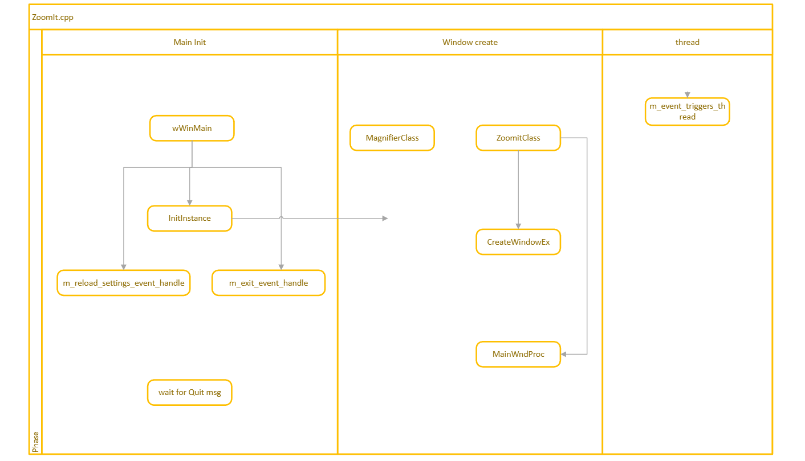
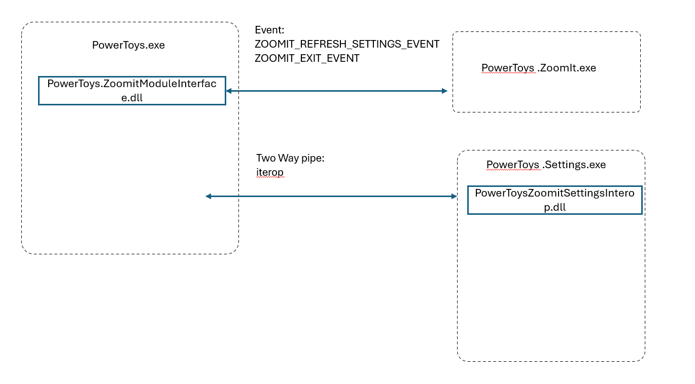

# ZoomIt Module

[Public overview - Microsoft Learn](https://learn.microsoft.com/en-us/windows/powertoys/zoomit)

## Quick Links

[All Issues](https://github.com/microsoft/PowerToys/issues?q=is%3Aopen%20label%3AProduct-ZoomIt)<br>
[Bugs](https://github.com/microsoft/PowerToys/issues?q=is%3Aopen%20label%3AProduct-ZoomIt%20label%3AIssue-Bug%20)<br>
[Pull Requests](https://github.com/microsoft/PowerToys/pulls?q=is%3Apr+is%3Aopen+label%3AProduct-ZoomIt)<br>
[UI test coverage and execution](../../../src/modules/ZoomIt/Tests/ZoomIt.UITests/README.md)

## Overview

ZoomIt is a screen zoom and annotation tool originally from Microsoft's Sysinternals suite. It allows users to:

- Zoom in on specific areas of the screen
- Draw and annotate on the screen while zoomed in
- Use a timer for presentations or breaks
- Pan and move while zoomed in
- Record screen activity with audio

ZoomIt runs in the background and is activated via customizable hotkeys.

## Special Integration Considerations

Unlike other PowerToys modules, ZoomIt has some unique integration aspects:

1. **Registry-based Settings**: ZoomIt uses registry settings instead of JSON files (which is the standard for other PowerToys modules). This was required to maintain compatibility with the standalone Sysinternals version.

2. **Dual Source of Truth**: The PowerToys repository serves as the source of truth for both the PowerToys version and the standalone Sysinternals version, with build flags to differentiate between them.

3. **Settings Integration**: A special WinRT/C++ interop library was developed to bridge between PowerToys' JSON-based settings system and ZoomIt's registry-based settings.

## Technical Architecture

The ZoomIt module consists of the following components:

1. **ZoomIt Executable** (`PowerToys.ZoomIt.exe`): The main ZoomIt application that provides the zooming and annotation functionality.

2. **Module Interface** (`PowerToys.ZoomItModuleInterface.dll`): Implements the PowerToys module interface to integrate with the PowerToys runner.

3. **Settings Interop** (`ZoomItSettingsInterop`): A WinRT/C++ interop library that enables communication between PowerToys settings and ZoomIt's registry settings.



### Directory Structure

```
src/
├── modules/
│   └── ZoomIt/
│       ├── Tests/ZoomIt.UITests/   # winappcli UI tests and deterministic fixtures
│       ├── ZoomIt/             # Main ZoomIt application code
│       ├── ZoomItModuleInterface/  # PowerToys module interface implementation
│       └── ZoomItSettingsInterop/  # WinRT/C++ interop for settings
├── settings-ui/
│   └── Settings.UI/
│       ├── SettingsXAML/
│       │   └── Views/
│       │       └── ZoomItPage.xaml  # ZoomIt settings page UI
│       └── ViewModels/
│           └── ZoomItViewModel.cs   # ZoomIt settings view model
└── common/
    └── sysinternals/          # Common code from Sysinternals
```


## Settings Management

ZoomIt's settings are stored in the Windows registry instead of JSON files to maintain compatibility with the standalone version. The settings include:

- Hotkey combinations for different modes (zoom, draw, etc.)
- Drawing options (colors, line thickness, etc.)
- Font settings for text annotations
- Microphone selection for recording
- Custom file paths for demo mode and break backgrounds

The `ZoomItSettingsInterop` library handles:
1. Loading settings from registry and converting to JSON for PowerToys settings UI
2. Saving changes from the settings UI back to the registry
3. Notifying the ZoomIt application when settings change



## Integration Steps

The integration of ZoomIt into PowerToys involved these key steps:

1. **Code Migration**:
   - Moving code from the Sysinternals ZoomIt repository to `src/modules/ZoomIt/ZoomIt`
   - Adding required common libraries to `src/common/sysinternals`
   - Sanitizing code for open source (removing private APIs, undocumented details, etc.)
   - Ensuring no private APIs (validated through APIScan)
   - Removing references to undocumented implementation details, constants, and names
   - Standardizing dependencies with other PowerToys utilities

2. **Module Interface Implementation**:
   - Creating the PowerToys module interface
   - Adding process management (start/terminate)
   - Implementing event-based communication for settings updates
   - Adding named events for communication between PowerToys and ZoomIt

3. **Settings Integration**:
   - Extracting ZoomIt settings code to a shareable component
   - Creating a WinRT/C++ interop library for registry-JSON conversion
   - Implementing all settings UI controls in PowerToys settings
   - Building `ZoomItSettingsInterop` as a bridge between registry and JSON settings

4. **PowerToys Integration**:
   - Adding ZoomIt to the PowerToys runner
   - Adding GPO rules for ZoomIt
   - Implementing telemetry and logging
   - Creating OOBE (out-of-box experience) page with animated tutorial
   - Adding ZoomIt to process termination list for proper cleanup
   - Adding telemetry events documentation

5. **UI/UX Adjustments**:
   - Redirecting ZoomIt's settings UI to PowerToys settings
   - Handling hotkey conflicts with warning notifications
   - Modifying tray icon behavior
   - Removing original ZoomIt options menu entries
   - Adding Sysinternals attribution on the settings page

6. **Build System Updates**:
   - Adding ZoomIt to the PowerToys solution
   - Implementing build flags for standalone vs. PowerToys versions
   - Adding signing for new binaries
   - Fixing analyzer errors and code quality issues

## Debug Instructions
1. Build the entire PowerToys solution at least once.
2. Set `runner` as the startup project and start debugging.
3. Once the PowerToys Settings app is running and ensure ZoomIt is activated.
4. Set `ZoomIt` as the startup project in Visual Studio.
5. Press `Ctrl + Alt + P` and attach ZoomIt to the process.
6. You should now be able to set breakpoints and step through the code.

## Special Implementation Details

### Snip With Dictation

Enable dictation in ZoomIt's SNIP options, then `Ctrl+6` and start dragging. Tapping `Space`
at any point during the drag opens the microphone, and on mouse up the captured image and
the transcription are published together. A single paste then delivers a screenshot plus a
spoken annotation or instruction into targets such as Copilot Chat.

#### Delivering both halves in one paste

`ClipboardPayload` publishes the snip in every format that can carry it. Only two mainstream
Windows clipboard formats carry text and an image in a single payload, and both are
published: `CF_HTML` (with the image inlined as a base64 ``) and `Rich Text Format`
(with the image embedded as a `\pict\pngblip`). Everything else on the clipboard is
single-payload by definition, so there is no third option. `CF_HTML` and RTF are published
first, ahead of `CF_DIB` and `CF_UNICODETEXT`, because clipboard enumeration order is
`SetClipboardData` call order and some consumers take the first format they recognize.

That is enough for applications that read a rich format - OneNote and Word paste the image
and the text together. It is not enough for chat surfaces. The GitHub Copilot CLI and the
Visual Studio Code chat input choose exactly one payload, and prefer text: the CLI's paste
handler reads the clipboard text and, if it is non-empty, inserts it and never looks at the
image; only when the text is empty does it fall through to attaching the image. No
combination of clipboard formats changes that, because the choice is made in the
application, not by the clipboard.

`PasteChaperone` closes that gap by splitting the user's single gesture into two pastes. It
publishes the image on its own, installs a low level keyboard hook, and waits. When it sees
a physical `Ctrl+V` it stops hooking, lets the target consume the image, then swaps the
clipboard to the transcription and synthesizes a second `Ctrl+V`. Once that is delivered the
full multi-format payload is restored so a later paste into OneNote or Word still gets
everything. The user presses `Ctrl+V` once and receives the screenshot as an attachment
followed by the dictated instruction.

The details that matter:

- The hook must ignore `LLKHF_INJECTED`, or the synthesized paste retriggers the sequence.
- A low level keyboard hook is dispatched on the thread that installed it and that thread
  must be pumping messages, hence the dedicated chaperone thread.
- `SetTimer` with a `NULL` window ignores the requested id and returns a new one, so the
  returned values have to be stored and compared against `msg.wParam`.
- Every stage records `GetClipboardSequenceNumber`. If it no longer matches, the user copied
  something else and the sequence abandons quietly rather than overwriting their clipboard.
- Arming succeeds only after the image is published and the low-level hook is installed.
  If either step fails, the caller publishes the combined payload instead of leaving an
  image-only clipboard behind.
- Electron applications can hold the clipboard open while asynchronously creating an image
  attachment. Stage transitions retry for a bounded interval while the clipboard sequence
  and foreground target remain unchanged.
- The second paste waits for the physical `Ctrl` to come up first, so the synthesized key
  events do not interleave with the user's own.
- If no paste arrives within a minute the combined payload is restored, leaving the user
  exactly where they would have been had the chaperone never armed.

The behavior is always enabled for dictation snips.

Arming dictation from inside the drag rather than from a global chord is deliberate. The
snip hotkeys have already consumed `Ctrl+6` (snip), `Ctrl+Shift+6` (snip to file) and
`Ctrl+Alt+6` (snip with OCR), leaving only cumbersome combinations. The modal drag loop in
`SelectRectangle` consumed nothing but `ESC`, so a keystroke there costs no global hotkey
namespace, and the user's hand is already on the mouse. It also matches the way the feature
is actually used: the decision to annotate usually comes after the selection is up.

Starting is one way for the duration of a drag; there is no stop, so a stray second tap
cannot discard words that have already been transcribed. Key auto repeat is filtered with
bit 30 of `lParam`.

#### Recognition engines

`DictationSession` tries two engines and silently falls back, which is what lets the
feature work with no setup at all:

1. `whisper.cpp` with a quantized multilingual `base` model. The model is split into three
   source files below GitHub's per-file warning threshold and linked as `RCDATA`; the runtime loader
   presents those resources as one contiguous model stream without extracting anything to
   disk. Recognition is offline and works identically in packaged PowerToys and standalone
   ZoomIt. Recognition uses the current user's Windows display language, reduced to
   its ISO language code (for example, `de-DE` becomes `de`). If Windows language
   lookup fails or Whisper does not support that language, a diagnostic is logged
   and automatic language detection is used. Transcription is not translated.
2. SAPI (`CLSID_SpInprocRecognizer`) with a dictation grammar. Entirely on device, needs no
   privacy consent or package identity, and remains available if the embedded model or
   Whisper capture path cannot initialize.

#### Recognition accuracy

ZoomIt embeds `ggml-base-q5_1.bin` (59,707,625 bytes), whose SHA-256 is
`422f1ae452ade6f30a004d7e5c6a43195e4433bc370bf23fac9cc591f01a8898`. The quantized
`base` model supports multilingual transcription while reducing the embedded model
and inference working set compared with `small.en`.

`Prewarm` loads the model on the dictation worker while the user begins selecting the snip.
Audio is captured during the drag, converted to mono floating-point PCM, resampled to
Whisper's 16 kHz input rate, and transcribed when the mouse is released. Finalization is
allowed up to twenty seconds for Whisper because inference, unlike SAPI event draining, is
CPU-bound. The completed selection border, dimmed exterior, and badge remain visible, the
pointer returns to the normal arrow, and the badge shows `Transcribing - Press Esc to cancel.`
alongside a drawn, rotating progress ring. Capture exclusion keeps the selection overlay
out of the screenshot without hiding it, and its exterior opacity stays unchanged on
release. Escape cancels inference and abandons the snip without changing the clipboard.
If a recognizer does not quiesce by the bounded deadline, ZoomIt requests cancellation,
releases the selection UI, and lets the application-lifetime recognition worker drain in
the background rather than retaining the modal desktop overlay.

The badge fits its status and transcript text, with a maximum width of 520 DIPs and up to
three wrapped transcript lines. Its initial width accommodates both the startup and listening
labels, so opening the microphone does not resize the popup.
It publishes its rendered pixels with `UpdateLayeredWindow`
so the status and animation remain visible while finalization blocks the UI message loop,
even when the selection overlay has pending paint messages.
During transcription it reserves space for the whole spinner and keeps the text, width,
and position fixed throughout the animation.
The native `BadgeWindowTests` regression tests compare client-rendered badge pixels and
window bounds, covering worker-thread startup updates and spinner rendering without
pumping the UI queue during finalization.
The native `SelectionWindowTests` exercise the real overlay and desktop capture to confirm
that a retained selection keeps its opacity and is excluded from screenshots while still
visible. These tests require an unlocked interactive Windows desktop.

Audio capture for recording is independent from dictation. The microphone chooser applies
to both features, but disabling "Include microphone in recording" does not disable
dictation.

Two things are easy to get wrong in the SAPI path and produce an engine that runs happily
while hearing nothing:

- The in process recognizer has no audio source until one is set, and passing `nullptr` to
  `SetInput` does **not** select a default. A capture device has to be resolved explicitly
  from the `SPCAT_AUDIOIN` token category.
- The thread that calls `ISpRecoContext::GetEvents` must have joined the same multithreaded
  apartment the context was created in, so the event loop calls `CoInitializeEx` itself.

#### Choosing the microphone

Dictation captures from the microphone selected on the Record page, so there is a single
microphone setting for the whole application. Whisper enumerates Core Audio capture
endpoints and matches the endpoint id embedded in the Windows `DeviceInformation` id that
ZoomIt persists in `MicrophoneDeviceId`. An empty, stale, or unplugged selection falls back
to the normal Windows default capture endpoint.

SAPI identifies capture devices by its own token ids. Its fallback path resolves the stored
Windows device id to a friendly name and matches that against `SPCAT_AUDIOIN` token
descriptions.

Descriptions are read directly from the token rather than with `SpGetDescription`, because
`sphelper.h` pulls in ATL and a number of deprecated APIs.

Components:

| File | Responsibility |
|------|----------------|
| `SelectRectangle.{h,cpp}` | Raises `OnDragStarted` / `OnDictateRequested` / `OnSelectionChanged` / `OnDragCompleted` / `OnCancelled` so the caller can react to the drag without owning the modal loop |
| `DictationSession.{h,cpp}` | Speech to text on a dedicated MTA worker thread. The UI thread is blocked inside the modal selection loop, so recognition cannot run on it |
| `WhisperRecognizer.{h,cpp}` | Loads the embedded model, captures the selected Core Audio endpoint, resamples it to 16 kHz mono, and runs CPU inference |
| `DictationBadge.{h,cpp}` | Layered, capture excluded overlay showing dictation status, centered on the top edge of the selection and following it as it is dragged |
| `ClipboardPayload.{h,cpp}` | Publishes `CF_HTML`, `Rich Text Format`, `PNG`, `CF_DIB`, `CF_BITMAP`, `CF_HDROP` and `CF_UNICODETEXT` in one clipboard transaction |
| `PasteChaperone.{h,cpp}` | Splits one Ctrl+V into an image paste followed by a text paste, for applications that accept only one of the two |

Notes:

- Format order matters. `CF_HTML` and `Rich Text Format` are published first because they are
  the only formats that carry text and image together, and enumeration order is
  `SetClipboardData` call order; applications otherwise choose whichever format they prefer.
- `Start` only queues work on the recognition thread, so it cannot report whether the
  microphone actually opened. The badge is driven by `OnStatusChanged` instead, and `Stop`
  waits for a queued start to land before deciding there is nothing to finalize; otherwise
  a quick drag silently discards the dictation.
- Dictation is off by default because it opens the microphone. When `SnipDictateEnabled` is
  clear, `Space` during a drag does nothing and a snip behaves exactly as it always has.
- The options UI is deliberately just the enable toggle.
  `SnipDictateToggleKey` (a snip that starts already listening), `SnipDictateOnSnip`,
  `SnipDictatePrefix`, `SnipDictateGrace` and `SnipDictateClipboardFormats` remain registry
  only settings.
- The default backend is embedded Whisper. It needs no package identity or network access,
  so it works in both the PowerToys build and the standalone Sysinternals build.
- With nothing transcribed the clipboard receives image formats only, so a silent dictation
  snip behaves like a plain snip.

### Font Selection

ZoomIt requires storing font information as a binary LOGFONT structure in the registry. This required special handling:

- Creating P/Invoke declarations for Windows font APIs
- Base64 encoding the binary data for transfer through JSON
- Using native Windows dialogs for font selection

### Hotkey Management

ZoomIt registers hotkeys through the Windows RegisterHotKey API. Special handling was needed to:

- Detect and notify about hotkey conflicts
- Update hotkeys when settings change
- Support modifier keys

### Process Communication

Communication between PowerToys and ZoomIt uses:
- Command-line arguments to pass PowerToys process ID
- Named events for signaling settings changes and exit requests
- Windows messages for internal ZoomIt state management

## Implementation Challenges

Several challenges were encountered during ZoomIt integration:

1. **First-Run Behavior**:
   - Font loading crashed when no ZoomIt data existed in registry
   - Hotkeys weren't registered on first run with no existing data
   - Implemented safeguards to handle missing registry data

2. **Settings Synchronization**:
   - Modifier keys for shortcuts weren't correctly updated when settings changed
   - Implemented proper event notification for settings changes
   - Added hotkey conflict detection and warnings

3. **File Interaction**:
   - ZoomIt file pickers changed the working directory of the Settings project
   - Fixed to maintain proper directory context

4. **Drawing Issues**:
   - Color settings lacking opacity caused drawing functionality to fail
   - Removed internal state settings that weren't truly editable

5. **Dual-Build Support**:
   - Added build flags to support both PowerToys and standalone Sysinternals versions
   - Implemented different executable properties based on build target

## Source Code Management

The PowerToys repository serves as the source of truth for both PowerToys and Sysinternals standalone versions of ZoomIt. Key repositories involved:

- Utility repo: `https://dev.azure.com/sysinternals/Tools/_git/ZoomIt`
- Common library repo: `https://dev.azure.com/sysinternals/Tools/_git/Common`

The integration process can be tracked through [PR #35880](https://github.com/microsoft/PowerToys/pull/35880) which contains the complete history of changes required to properly integrate ZoomIt.
