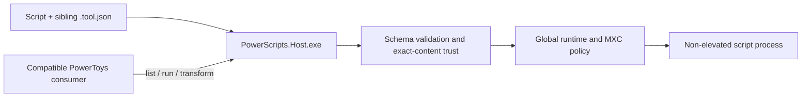

# PowerScripts design

> Prototype. This describes the current contract; historical security alternatives
> remain in the proposal documents linked from [security design](SECURITY-DESIGN.md).

## Architecture and ownership



The package owns behavior and the declared contract. The shared Host owns discovery,
validation, trust, runtime dispatch, and output normalization. Consumers own parameter
UX, invocation timing, presentation, cancellation, and result lifetime. They do not
launch scripts directly or reference the execution engine.

## Descriptor contract

The sidecar follows the MCP Tool shape. `name`, optional human metadata, and both
`inputSchema`/`outputSchema` describe the script. Requiring outputSchema is a
PowerScripts profile rule, not an MCP requirement.
See the complete example and supported keyword/type subset in [README](README.md).

Both schemas have closed object roots. One required `text` string or `files`
array identifies primary data; neither means none. Named options belong in the
input's closed `parameters` object, not at the root or in a custom extension.
Options are string, integer, boolean, string enum, or `format: "file-path"`.
Schemas enforce defaults, presence, bounds, patterns, and file counts/restrictions.
Omitting `maxItems` is unlimited; zero is an actual zero bound.
File extension hints live on path strings as `x-powerscript.extensions`.
Media and rich documents remain path strings, not special schema primitive types.

Root `x-powerscript` contains only discovery, provenance, icon, and capability hints.
There are no runtime, function, primary I/O, file-filter, or isolation settings there.
`.py`/`.ps1` infer built-in runtime. No comments or source inspection provide metadata.

## Runtime contract

Python runs the script directly, starting at top-level statements. `json.load(sys.stdin)`
reads `text` or `files` and typed `parameters`; no callable entry or import runner exists.
PowerShell receives native `param(...)` bindings through a schema-shaped JSON request
and native splatting. This preserves booleans, empty strings, and path arrays in
both Windows PowerShell and PowerShell 7.

All runtimes use literal stdout for text, `{"files":[...]}` for files, and no
result for none. Host `transform` wraps results as `{"text":"..."}`, `{"files":[...]}`,
or `{}`. Diagnostic stdout from none-output scripts is forwarded to stderr.
Invalid shapes/constraints fail; strings are never guessed to be paths.

Optional `x-execute` describes an advanced command/argument/stdin recipe. Other
extensions require such a recipe. It bypasses built-in runtime selection, never
shared trust, never-elevated execution, or isolation.

## Host API

```text
Host.exe list --json [--consumer <id>] [--input <shape>] [--output <shape>]
Host.exe run <id> [--files ...] [--set name=value ...]
Host.exe transform <id>                   (UTF-8 JSON stdin/stdout)
```

Discovery includes schema-authoritative `inputSchema`/`outputSchema` and derived
`io`, typed `parameters`, and file compatibility fields for existing consumers.
The derived fields are read models, not a second authoring format.
`none` describes primary data, not whether named options exist.
Optional consumer IDs restrict discovery only. Management-only flags can expose
disabled/unconfigured scripts but cannot make them executable.

See [consumer integration](CONSUMER-INTEGRATION.md) for the client, file ownership,
noninteractive trust, and validation requirements.

## Configuration and security

There are no per-script settings, overrides, policy recommendations, storage APIs,
or policy dialogs. Details are read-only descriptor metadata and effective global
isolation, with external editing and explicit refresh. All runtime/MXC configuration
is global. Trust remains bound to exact body/descriptor content.

Python has one Linux/WSL choice: global MXC on selects managed WSLC; MXC off selects
the configured user distribution. Neither route silently falls back to the other.
Windows and managed Linux enforce the selected global policy or fail closed if
it cannot be honored. Managed Linux requires MXC/filesystem protection
and acknowledged global exceptions for unsupported UI/least-privilege policies.
Explicit WSL recipes are refused while MXC is enabled, including platform defaults.

The Debug launcher is a temporary shared-client consumer. The former standalone
Explorer handler is removed; future file integration belongs to File Explorer Add-ons.

## Open decisions

- Version the CLI and JSON response contract.
- Define packaged Python dependencies.
- Decide the long-term shape of advanced launch recipes.
