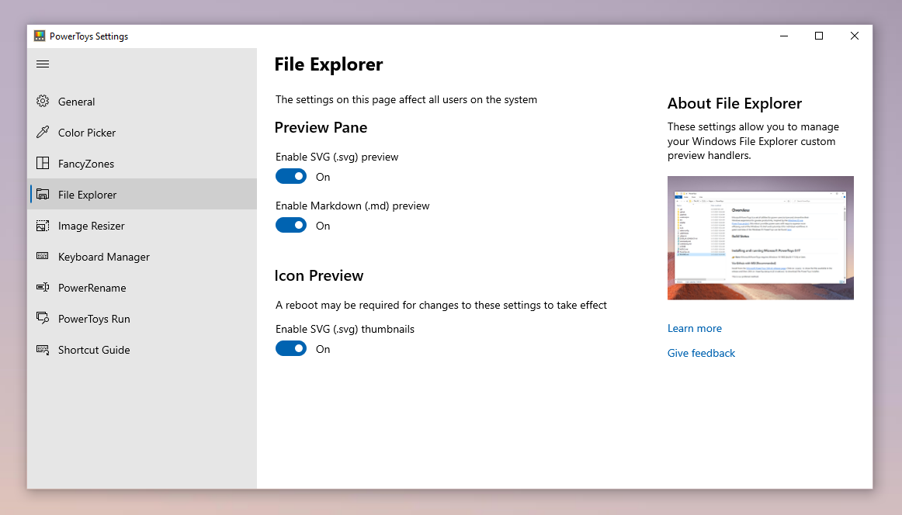

# File Explorer

## End user facing:

[Please visit our overview](https://aka.ms/PowerToysOverview_FileExplorerAddOns)

## Developing

### PowerScripts context menu

`FileExplorerScripts.ShellExtension` is the native shell command; `FileExplorerScripts` owns
catalogue refresh, selection handoff, parameter UX and notifications. `FileExplorerScripts.Core`
uses only `PowerScripts.Client` for execution and exports results as new, non-overwriting files.
The existing `powerpreview` module starts/stops the catalogue process. Preview and thumbnail
handlers do not load or execute scripts.

The runner-owned app also receives context-menu requests through AppLifecycle activation,
serialized per app instance. It retains private Host stdio sessions for catalogue and execution;
metadata, approval and policy are still revalidated for every request. Windows sandboxes and
interpreters remain fresh. Progress windows are constructed only after the configured delay.
The runner's stop event is monitored before Host prewarm, so disabling the module also cancels
startup. The runner retains ownership until shutdown completes and uses a kill-on-close process
job to contain the catalogue and its Host descendants if graceful shutdown times out or the runner exits.

Enable the integration in **PowerScripts app > Consumer modules > File Explorer**. The
**Show parameter options before running** preference is in File Explorer Add-ons settings
and defaults on. With it off, required parameters without valid defaults disable the action.
No per-script settings are stored. Scripts receive the complete selection once.

**Show execution status after (seconds)** controls the status popup delay, from 0 to 600
seconds (default 2; 0 shows it immediately). Timing starts after parameter/destination choices,
when execution preparation begins. Fast successful runs do not open a status window. Longer runs
show the script, selection count, elapsed time and preparation/execution/export stage, with cancellation.
Closing a running status window hides it without cancelling. Errors appear immediately and remain
visible with copyable details, regardless of the delay. Cancellation cannot undo prior side effects;
failed/interrupted requests are never automatically retried. There is still no result preview.

The flat PowerScripts submenu shows up to 14 compatible scripts. A picker appears only when
matching scripts overflow the menu, the cache is truncated, or discovery needs recovery.
Script entries use the validated `iconPath` returned by Host discovery. Authors can add a
package-relative `.ico` through `x-powerscript.icon`; invalid/missing icons do not hide the script.
Discovery runs outside Explorer; invocation revalidates the current script through Host.
Results are exported to the selected files' common folder, or an explicitly chosen folder for
mixed-parent selections. Result export never replaces originals; the default MXC policy keeps
selected originals read-only. Disabling isolation retains PowerScripts' existing risk model.
Text becomes UTF-8 `.txt`; supported inline media is saved in its validated format. No result
window is opened and returned files are never executed automatically.

The selection contract is local regular files, including file-backed images/audio/video.
File-input scripts retain their extension/count matching. A single locally available PNG, JPEG,
WebP, WAV, MP3 or FLAC can also match image/audio-input scripts that accept its MIME type.
Menu classification reads at most 64 header bytes (plus a four-byte MP3 frame after ID3 metadata),
on Explorer's allowed slow/background state path, or during classic-menu enumeration if
no verified state is available. The fast state callback never reads media.
Cloud placeholders are not hydrated, and media is not decoded or transcoded in Explorer.
Invocation revalidates and supplies the existing scalar/array media payload, at most 16 MiB.
Multiple selections, larger assets and unsupported formats remain file-input only.
Directories, reparse points and UNC/device paths remain excluded.
Windows and managed Linux execution continue to use PowerScripts' existing runtime configuration.

Build the Core, native shell, app and `powerpreview` projects for the same architecture.
Release uses the signed sparse package produced by the shell project. Debug uses a loose
developer registration (Developer Mode required), without importing a certificate or enabling
unsigned-package support in production. Restart the Debug Runner after building `powerpreview`.
Modern-menu registration does not force an Explorer restart; the menu may require a new Explorer
window to appear. The classic menu uses the same `IExplorerCommand` implementation.

See [consumer integration guidance](..\PowerScripts\CONSUMER-INTEGRATION.md) for the shared contract.

The native menu integration check requires a running Debug consumer with the image/audio demo
scripts in its catalogue. From the shell project folder in an x64 Developer Command Prompt:
```
cl /EHsc /std:c++20 /DUNICODE /D_UNICODE /DWIN32_LEAN_AND_MEAN /DNOMINMAX /I ..\..\..\..\packages\Microsoft.Windows.CppWinRT.2.0.250303.1\include ShellExtensionTests.cpp /link windowsapp.lib shell32.lib shlwapi.lib ole32.lib user32.lib
ShellExtensionTests.exe <shell DLL path> <valid PNG path> <valid WAV path> [invalid or non-media paths...]
```
This checks both callback orders, selection replacement, and fast/verified/classic menu latency.

-  Add new C++ DLL project in the preview pane folder. This DLL is actual preview handler, i.e. implements IPreviewHandler/IThumbnailProvider interface.
-  Add new .NET EXE project in the preview pane folder. This EXE is being spawned by C++ DLL to generate preview/thumbnail.

## Installation

### MSI (Recommended)

To add a new Previewer update the `Product.wxs` file in `PowerToysSetup` similar to existing Previewer to register the Preview Handler. More details about registration of Preview Handlers can be [found here.](https://learn.microsoft.com/windows/win32/shell/how-to-register-a-preview-handler) - implemented in [modulesRegistry.h](../../common/utils/modulesRegistry.h).

### Directly registering/unregistering DLL's
**[Important] This method of registering Preview Handler DLL's is not recommended. It could lead to registry corruption.**
#### Registering Preview Handler
1. Restart Visual studio as administrator. 
2. Sign `XYZPreviewHandler` and its dependencies. To sign an assembly in VS, follow steps given [Create and sign an assembly with a strong name by using Visual Studio](https://learn.microsoft.com/en-us/dotnet/standard/assembly/sign-strong-name#create-and-sign-an-assembly-with-a-strong-name-by-using-visual-studio).
3. Build `XYZPreviewHandler` project.
4. Open developer command prompt from `Tools > Command Line > Developer Command Prompt`.
5. Run following command for each nuget and project dependency to add them to Global Assembly Cache(GAC). 
```
gacutil -i <path to dependency>
```
6. Run following commands to register preview handler.
```
cd C:\Windows\Microsoft.NET\Framework64\4.0.x.x
gacutil -i <path to XYZPreviewHandler.dll>
RegAsm.exe /codebase <path to XYZPreviewHandler.dll>
```
7. Restart Windows Explorer process.

#### Unregistering Preview Handler
1. Run following commands in elevated developer command prompt to unregister preview handler. 
```
cd C:\Windows\Microsoft.NET\Framework64\4.0.x.x
RegAsm.exe /unregister <path to XYZPreviewHandler.dll>
gacutil -u XYZPreviewHandler
```

## Debugging
Since in-process preview handlers run under a surrogate hosting process (prevhost.exe by default), to debug a preview handler, you need to attach the debugger to the host process. 
1. Click on a file with registered extension to start host process.
2. Attach debugger in Visual studio from `Debug->Attach to Process` and select `prevhost.exe` with type `Managed(version), x64`.

## Managing Preview Handlers

After successful integration, your preview handler should appear in the PowerToys settings UI under the `File Explorer Preview` Tab. In here you should be able to enable and disable all the preview handles.


